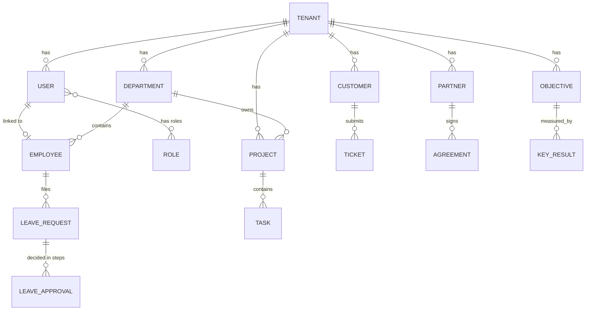

# Enterprise Management Platform (EMP): Product Requirements Document

**Version:** 3.1 (Modular services, hierarchy and leave rules)  
**Product type:** Multi-tenant SaaS enterprise management platform, sold as separately chosen services  
**Status:** Draft for approval  
**Date:** October 2026

> Packaging and entitlement rules in Section 04 are also kept in `docs/MODULE_MODEL.md`. If the two ever differ, resolve the difference before building; this PRD wins on product questions.

---

## 01. Product Vision

> Develop a modular, enterprise-grade management platform that lets any organization run its people, customers, partners, performance, projects, and support requests from a single integrated system, shaped around the organization's own hierarchy and rules.

The platform is configurable, so organizations define their own business processes rather than adapting to rigid, predefined software workflows. Authority in the system mirrors the real company hierarchy, from the owners down to the newest employee.

## 02. Objectives

- **Centralize** operations into a single source of truth.
- **Eliminate** disconnected systems and data silos.
- **Mirror** the real company hierarchy in permissions, approvals, and reporting.
- **Connect** the three relationship domains (employees, customers, partners) to one performance view.
- **Standardize** workflows while allowing custom organizational adaptations.
- **Increase** visibility through unified, role-based reporting.
- **Support** organizations of any size, from SMBs to large enterprises.
- **Scale** through a modular, microservices-ready architecture.

## 03. Target Industries

Government · Manufacturing & Logistics · Healthcare & Education · NGOs & Professional Services · Financial Institutions · Telecommunications · Retail · Hospitality · Agriculture · Construction · Technology

## 04. Module Catalog & Packaging

> EMP is sold and run as separate services. Each client (tenant) chooses the services it wants. Every service must work on its own with only the always-on core and its own hard dependencies, and never assume another service is present.

### Always-on core (every tenant)

Authentication, organization and hierarchy, users and roles, module entitlements, notifications, documents, the shared approval engine, the item catalog, and shared reference data (units, currencies, tax codes, payment terms).

### Optional services

| Service              | Manages                                                                         | Hard requires | Optional integrations                                               |
|----------------------|---------------------------------------------------------------------------------|---------------|---------------------------------------------------------------------|
| **HR**               | Employees, recruitment, attendance, leave, training                             | None          | Projects (leave-aware assignment), EPM, Manufacturing (labor cost)  |
| **CRM**              | Leads, customers, opportunities, pipeline                                       | None          | Sales, Service Desk, PRM, CX, EPM                                   |
| **PRM**              | Partners, vendors, suppliers, resellers, agreements, partner portal, scorecards | None          | CRM (referrals), Procurement, EPM                                   |
| **EPM**              | Objectives, KPIs, scorecards, review cycles                                     | None          | Every service (KPI feeds); Finance (budgets and forecasts)          |
| **Projects & Tasks** | Projects, assignment, progress                                                  | None          | HR, EPM                                                             |
| **Service Desk**     | Internal and external tickets, SLAs                                             | None          | CRM, PRM, CX                                                        |
| **Finance**          | Journals, receivables, payables, periods, financial statements                  | None          | Receives postings from Sales, Procurement, Inventory, Manufacturing |
| **Sales**            | Quotations, sales orders, deliveries, invoices                                  | None          | CRM, Inventory, Finance, CX                                         |
| **Procurement**      | Requisitions, purchase orders, receipts, supplier bills                         | None          | Inventory, Finance, PRM, Planning                                   |
| **Inventory**        | Items by warehouse, stock ledger, valuation                                     | None          | Sales, Procurement, Manufacturing, Finance                          |
| **Logistics**        | Shipments and tracking                                                          | None          | Sales, Procurement, Inventory                                       |
| **Planning**         | Shortages, reorder suggestions                                                  | Inventory     | Procurement, Manufacturing, Sales                                   |
| **Manufacturing**    | Bills of materials, routings, work orders, quality checks, production cost      | Inventory     | HR, Finance, Planning                                               |
| **CX**               | Surveys, feedback, customer 360 view                                            | None          | CRM, Service Desk, Sales                                            |

> **Assumption:** PRM means Partner Relationship Management and EPM means Enterprise Performance Management (objectives and KPIs). The operations services (Finance through CX) are planned; their detailed requirements will be added in a PRD addendum before they are built.

### Shared data rules

- The core owns minimal shared records: **Party** (name, contacts, tax ID, addresses), the item catalog, and reference data.
- Each service adds its own profile on top of a Party. A supplier is a Party with a supplier profile and does not require PRM. A customer does not require CRM.
- **Graceful degradation:** without CRM, Sales manages its own customers; without HR, labor cost uses a manual rate; without Finance, documents work but post no journals; without PRM, supplier scorecards are hidden.
- Services communicate through typed contracts and domain events. One service never imports another's internals. Each integration is an optional adapter that activates only when both sides are enabled.

### Entitlements

- Every service has a manifest listing its dependencies, optional integrations, permissions, routes, navigation entries, dashboard widgets, and KPI definitions.
- A tenant's entitlement record lists the services it has enabled. It is enforced in routing, navigation, data access, dashboards, and the central policy check, not only by hiding menu items.
- Opening a service the tenant does not have shows a "not available on your plan" screen.
- Enabling a service requires its hard dependencies. Disabling a service that others require is blocked with an explanation. Disabling keeps all data, and re-enabling restores it.
- Roles, permissions, widgets, KPIs, workflow triggers, and search results for disabled services do not appear.
- The Super Administrator toggles services per tenant; the Organization Administrator sees what is enabled.

### Bundles and industry presets

Presets are default bundles of services, never hard-coded behavior. Clients can always add or remove services.

| Bundle                | Typical services                                                    |
|-----------------------|---------------------------------------------------------------------|
| People & Work         | HR, Projects, EPM                                                   |
| Sales & Customers     | CRM, Service Desk, CX                                               |
| Partners & Suppliers  | PRM, Procurement                                                    |
| Distribution & Retail | Sales, Procurement, Inventory, Logistics, Finance                   |
| Manufacturing         | Inventory, Manufacturing, Planning, Procurement, Sales, Finance, HR |
| Full suite            | All services                                                        |

> Pricing and billing are not part of this document. Entitlement is a set of flags per tenant.

## 05. Company Hierarchy & Roles

EMP models the full chain of authority in a company, from ownership to junior staff. Each organization switches on only the layers it uses, so a small business can run flat while a large one uses every level.

### Full company hierarchy

    Board of Directors / Owners
     |
    Chief Executive Officer (CEO) / Managing Director
     |
     |-- Executive Team (C-level)
     |     COO (operations), CFO (finance), CTO (technology),
     |     CHRO (people), CMO / Sales Director (market)
     |
     |-- Heads of Department / Directors
     |     Finance, IT, Sales, Operations, Marketing, etc.
     |      |
     |      |-- Managers (mid-level, run a function inside the department)
     |      |    |
     |      |    |-- Supervisors / Team Leads (run a small team day to day)
     |      |    |    |
     |      |    |    \-- Employees (specialists, officers, assistants)
     |      |    |         \-- Junior staff, interns, trainees
     |
     \-- HR (sits beside the departments and serves all of them)

### Mapping to EMP roles

| Company level                    | EMP role                       | Scope and responsibilities                                                                                                                                                              |
|----------------------------------|--------------------------------|-----------------------------------------------------------------------------------------------------------------------------------------------------------------------------------------|
| Your company (SaaS owner)        | **Super Administrator**        | Platform level: manages tenants, plans, feature flags. Not part of any tenant's daily work.                                                                                             |
| Board / Owners / CEO             | **Organization Administrator** | Configures the organization, creates departments, appoints Heads of Department, sees all dashboards. Owners or the Board may be recorded as read-only approvers for CEO-level requests. |
| Executive team (C-level)         | **Executive**                  | Organization-wide visibility, EPM objectives and scorecards, senior approvals for long or special leave.                                                                                |
| Head of Department / Director    | **Head of Department**         | One per department. Creates projects and tasks, assigns work, **gives line approval on leave**, owns department KPIs.                                                                   |
| Managers                         | **Manager** (optional)         | Runs a function inside a department. Can assign tasks and give line approval for their reports when enabled.                                                                            |
| Supervisors / Team Leads         | **Team Lead** (optional)       | Day-to-day task assignment and first-line leave recommendation for a small team when enabled.                                                                                           |
| HR                               | **HR** (HR Officer, HR Head)   | Serves all departments. **Verifies and records leave**, manages employee records, attendance, recruitment, and policy.                                                                  |
| Employees, junior staff, interns | **Employee**                   | Completes tasks, submits leave, raises tickets, maintains own profile. Interns and trainees are Employees with restricted access flags.                                                 |
| Customers, applicants            | **External User**              | Sees only their own tickets or applications.                                                                                                                                            |
| Vendors, suppliers, resellers    | **Partner User**               | Sees only their own partner workspace (PRM).                                                                                                                                            |

### How authority flows

- **Downward (work):** Administrator appoints Heads of Department. Heads assign tasks to Employees, optionally through Managers and Team Leads.
- **Sideways (people matters):** HR serves every department and is independent of the department chain.
- **Upward (visibility):** Task progress, KPIs, and approvals roll up from Employee to Head of Department to Executive to Administrator.

## 06. Core Platform

### Authentication & Identity

- Email/Password, SSO via OAuth2/SAML, Multi-Factor Authentication
- Password recovery and session management

### Organization Management

- Multiple organizations, branches, departments, and teams with a customizable hierarchy (any of the levels in Section 05 can be enabled or hidden)
- Each department has exactly one Head of Department, appointed by the Organization Administrator
- Company branding (logos, primary colors via UI tokens) and global settings

### Role-Based Access Control (RBAC)

**Roles:** Super Administrator, Organization Administrator, Executive, Head of Department, Manager (optional), Team Lead (optional), HR, Employee, External User, Partner User.

**Permissions:** Create, Read, Update, Delete, Approve, Export, Manage Users, Configure Modules.

> **Rules:** Permissions are tied to feature flags to support tiered billing. A user can hold more than one role (for example Head of Department and Employee). No user can approve their own request.

## 07. Human Resource Management (HR)

#### Employee Management

Profiles, employment history, departments, positions, reporting line, contracts, documents, emergency contacts, skills, and certifications.

#### Recruitment

Job vacancies, applicant tracking (ATS), interview scheduling, candidate evaluation, offer management, and conversion of an applicant to an employee.

#### Attendance

Clock in/out, shifts, overtime, remote attendance tracking, and reports.

#### Leave Management

See Section 08.

#### Performance Records

Individual reviews, feedback, and history. Goals and KPIs are managed in EPM (Section 11) and feed into these reviews.

#### Training

Training programs, enrollments, certifications, and training records.

## 08. Leave Management

> Leave follows the usual two-part rule: the **line approver decides** whether the work can be covered, then **HR verifies and records** that the request meets policy and balance.

### Standard approval flow

| Step | Actor                                                                   | Action                                                                                                                                                             |
|------|-------------------------------------------------------------------------|--------------------------------------------------------------------------------------------------------------------------------------------------------------------|
| 1    | **Employee**                                                            | Submits the request with dates, leave type, and reason or supporting document if the type requires one.                                                            |
| 2    | **Line approver** (Head of Department; Manager or Team Lead if enabled) | Approves or rejects based on workload and team cover. A rejection ends the request with a reason.                                                                  |
| 3    | **HR**                                                                  | Verifies balance, policy, notice period, and blackout dates, then confirms and records the leave. HR may return a request to the employee for missing information. |
| 4    | **System**                                                              | Updates leave balance, team calendar, attendance, and dashboards, and notifies everyone involved.                                                                  |

### Approval chain by requester

| Who is requesting   | Step 1: Line approval                                                  | Step 2: Verification               |
|---------------------|------------------------------------------------------------------------|------------------------------------|
| Employee, intern    | Head of Department (or Team Lead / Manager)                            | HR                                 |
| Team Lead / Manager | Head of Department                                                     | HR                                 |
| Head of Department  | Executive or Organization Administrator                                | HR                                 |
| HR staff            | HR Head (HR Head is the line approver for HR)                          | Organization Administrator         |
| HR Head             | Organization Administrator                                             | Recorded by HR (not self-verified) |
| Executive / CEO     | Board or owner (recorded outside the system or by designated approver) | HR records                         |

### Policy rules (configurable per organization)

- **Statutory leave** (sick, maternity or paternity, bereavement): not refusable by the line approver. HR verifies documents and records; the Head of Department is notified.
- **Notice periods:** minimum advance notice per leave type (for example 7 days for annual leave).
- **Extended or special leave** (unpaid, sabbatical): adds a senior approver (Executive or Administrator) after step 2.
- **Blackout periods** (year-end, peak season) block or flag requests.
- **Minimum staffing:** warns or blocks when too many people in one team are off at once.
- **No self-approval:** enforced by the system.
- **Escalation:** if the line approver does not respond within a set time, the request escalates to the next level up. Optional delegation lets approvers nominate a stand-in while away.
- **Legal minimums** (annual leave days, sick leave, maternity) are set per country; each tenant configures its own leave types and entitlements.

### Leave statuses

Draft · Pending line approval · Pending HR verification · Approved · Rejected · Returned · Cancelled

> **Configurability:** the chain above is the default. Organizations can switch to HR-only approval or add steps through the Workflow Engine without code changes.

## 09. Customer Relationship Management (CRM)

**Features:** Lead management, customer database, contact management, sales opportunities, sales pipeline, communication logs, notes, documents, and linked tickets.

#### Sales Pipeline

Stages are fully configurable by each organization (for example Lead, Qualified, Proposal, Negotiation, Won/Lost).

#### Ownership and visibility

Each lead, customer, and opportunity has an owner. Heads of Department see their department's pipeline; Executives and Administrators see all. Customer history (deals and support tickets) lives on one record.

## 10. Partner Relationship Management (PRM)

PRM manages the organizations that work *with* the tenant rather than buy from it: vendors, suppliers, resellers, distributors, agencies, and contractors.

| Capability                    | Description                                                                                          |
|-------------------------------|------------------------------------------------------------------------------------------------------|
| Partner directory             | Partner profiles, categories, tiers, contacts, and status                                            |
| Onboarding & vetting          | Application, document collection (licenses, tax, insurance), approval workflow, and expiry reminders |
| Agreements                    | Contracts, terms, renewal dates, and version history                                                 |
| Partner portal                | Partner Users log in to see only their own agreements, tasks, tickets, and shared documents          |
| Deal registration & referrals | Partners register leads or referrals that flow into CRM with attribution                             |
| Orders & payments tracking    | Purchase or commission records and status (tracking only; accounting is out of scope)                |
| Partner scorecards            | On-time delivery, quality, response time, and revenue contribution, feeding EPM                      |

## 11. Enterprise Performance Management (EPM)

EPM connects strategy to daily work by cascading objectives down the hierarchy and measuring results with live data from every other module.

| Capability                      | Description                                                                                                                                                                           |
|---------------------------------|---------------------------------------------------------------------------------------------------------------------------------------------------------------------------------------|
| Strategic objectives            | Organization-level goals set by the Executive team or Administrator (OKR style: objective plus measurable key results)                                                                |
| Cascading goals                 | Objectives break down to departments, teams, and individuals, so each person's goals link to the company's                                                                            |
| KPIs                            | Defined metrics with targets, thresholds, and owners. Many are computed automatically from module data (sales won, tickets resolved, tasks completed, attendance rate, leave backlog) |
| Scorecards                      | Balanced views per organization, department, and partner                                                                                                                              |
| Review cycles                   | Scheduled reviews (quarterly, annual) with self, manager, and optional 360 feedback; results saved to the employee record in HR                                                       |
| Progress tracking               | Check-ins, status (on track, at risk, off track), and history                                                                                                                         |
| Executive performance dashboard | Rolls up every level into one view of how the organization is performing against its goals                                                                                            |

> **Scope note:** Core EPM is performance management and has no dependencies. **Budgets and forecasts are an optional capability that appears only when Finance is enabled**, because actuals come from posted journals. Financial consolidation is not included.

## 12. Task & Project Management

**Features:** Projects, tasks, subtasks, milestones, dependencies, assignments, deadlines, time tracking, and progress monitoring.

- The **Head of Department** creates projects and tasks and assigns them to employees in their department; Managers and Team Leads can assign within their teams when enabled.
- Employees update task status; the Head of Department reviews progress.
- Approved leave appears in assignment views so work is not assigned to someone who is away.
- Task completion feeds KPIs in EPM.

Kanban · List · Calendar · Timeline · Gantt Chart

## 13. Ticketing / Service Desk

Supports internal requests (HR, IT, Procurement, Facilities) and external requests (Customer Support, Complaints, Product Issues, Partner Support).

**Features:** Ticket creation, assignment, priorities, categories, SLA management, escalation rules, comments, attachments, status tracking, and linked Knowledge Base.

## 14. Workflow Engine

Organizations create custom workflows without modifying application code.

> **Strategic Note:** Evaluate integrating an existing engine such as Temporal, n8n, or Celery rather than building from scratch.

| Component  | Examples                                                                                        |
|------------|-------------------------------------------------------------------------------------------------|
| Triggers   | Employee Created, Leave Request Submitted, Ticket Created, Partner Applied, Objective Created   |
| Conditions | Department, User Role, Leave Type, Duration, Amount, Status, Location                           |
| Actions    | Assign User, Send Notification, Update Status, Create Task, Request Approval, Generate Document |

#### Requirements driven by the leave and hierarchy rules

- **Multi-step sequential approvals** (line approval, then HR verification, then optional senior approval).
- **Role-based and relationship-based approvers** ("requester's Head of Department", "any user with the HR role").
- **Conditional steps** (add a senior approver if leave exceeds N days or is of a special type).
- **Timeouts and escalation** to the next level up, plus approver delegation.
- **Self-approval block** and a full audit trail for every decision.

## 15. Document Management

**Features:** File upload, folders, version control, access permissions, document approval, digital signatures, and in-browser preview. **Types:** PDF, DOCX, XLSX, PPTX, images. Used by HR (contracts, medical certificates), PRM (partner agreements), and CRM (proposals).

## 16. Notification System

| Channels                                | Triggers                                                                                                                         |
|-----------------------------------------|----------------------------------------------------------------------------------------------------------------------------------|
| Email, SMS, Push, WhatsApp Business API | Task assignments, leave decisions, approvals awaiting action, ticket updates, KPI alerts, partner document expiry, announcements |

## 17. Reporting & Dashboards

| Dashboard          | Key metrics                                                                                                                          |
|--------------------|--------------------------------------------------------------------------------------------------------------------------------------|
| Executive          | Headcount, objective progress, KPI health, department performance, open tickets, revenue pipeline                                    |
| HR                 | Attendance, leave requests awaiting verification, leave balances, recruitment pipeline, workforce distribution                       |
| Head of Department | Department tasks, overdue work, team availability (including approved leave), department KPIs, leave requests awaiting line approval |
| CRM                | Leads, pipeline, conversion rates, customer growth                                                                                   |
| PRM                | Active partners, expiring documents, partner scorecards, referral revenue                                                            |
| EPM                | Objective alignment, KPI trends, review-cycle completion                                                                             |
| Operations         | Project status, SLA performance, workflow statistics                                                                                 |

## 18. Multi-Tenant Architecture & Data Strategy

- **Isolation:** Shared database, shared schema, strict `tenant_id` row-level isolation
- **Enforcement:** PostgreSQL Row-Level Security (RLS) plus FastAPI middleware
- **Configuration:** Organization-level feature toggles, branding, hierarchy levels, leave policy, and independent user management
- **Entitlements:** Enabled services per tenant are enforced in routing, data access, dashboards, and the policy check (Section 04)
- **External scoping:** External Users and Partner Users are restricted to rows linked to their own customer or partner record

## 19. Security

- **Authentication:** JWT, OAuth2, SSO, MFA
- **Data security:** TLS 1.3 in transit, AES-256 at rest
- **Auditing:** Immutable audit logs for all create, update, delete, and login actions, including every leave decision and role change
- **Compliance:** GDPR principles (right to be forgotten, data export), SOC 2 readiness

## 20. Recommended Technology Stack

| Layer         | Technology                                                        |
|---------------|-------------------------------------------------------------------|
| Frontend      | React.js (Vite), TypeScript, Tailwind CSS, shadcn/ui, React Query |
| Backend       | FastAPI (Python), SQLAlchemy 2.0 (async), Pydantic                |
| Database      | PostgreSQL 15+, OpenSearch (search)                               |
| Cache & Queue | Redis, Celery                                                     |
| File Storage  | AWS S3 or MinIO                                                   |
| Containers    | Docker; Docker Compose (early phases), Kubernetes (production)    |

## 21. API Standards

- RESTful APIs documented via OpenAPI (auto-generated by FastAPI), validated with Pydantic
- Authentication: `Authorization: Bearer <JWT_TOKEN>`

#### Example endpoints

    GET  /api/v1/employees // List with pagination/filtering
    POST /api/v1/employees // Create
    PUT  /api/v1/employees/{id} // Update
    DELETE /api/v1/employees/{id} // Soft delete
    POST /api/v1/leave-requests // Employee submits
    POST /api/v1/leave-requests/{id}/approve // Line approver or HR, per current step
    POST /api/v1/leave-requests/{id}/reject // Requires reason
    POST /api/v1/leave-requests/{id}/return // HR returns for information
    GET  /api/v1/partners // PRM directory
    GET  /api/v1/objectives // EPM objectives and key results

## 22. Data Model & Architecture

*All core tables include a `tenant_id` (UUID) for multi-tenant isolation.*

| Entity                    | Description           | Key attributes                                            | Relationships                                     |
|---------------------------|-----------------------|-----------------------------------------------------------|---------------------------------------------------|
| **Tenant**                | Root organization     | `id`, `name`, `subdomain`, `settings`                     | 1:N to all                                        |
| **User**                  | Login identity        | `id`, `tenant_id`, `email`                                | N:M Role, 1:1 Employee                            |
| **Department**            | Org unit              | `id`, `name`, `head_user_id`, `parent_id`                 | 1:N Employee, 1:N Project                         |
| **Employee**              | HR profile            | `user_id`, `department_id`, `manager_id`, `level`         | N:1 Department, self-reference for reporting line |
| **LeaveRequest**          | Leave application     | `employee_id`, `type`, `dates`, `status`, `current_step`  | N:1 Employee, 1:N LeaveApproval                   |
| **LeaveApproval**         | One decision per step | `request_id`, `step`, `approver_id`, `decision`, `reason` | N:1 LeaveRequest                                  |
| **Customer**              | CRM client            | `name`, `email`, `owner_id`                               | 1:N Opportunity, 1:N Ticket                       |
| **Partner**               | PRM organization      | `name`, `category`, `tier`, `status`                      | 1:N Agreement, 1:N Partner User                   |
| **Objective / KeyResult** | EPM goals             | `owner_id`, `parent_id`, `target`, `progress`             | Self-referencing cascade                          |
| **Project / Task**        | Work items            | `department_id`, `assignee_id`, `assigned_by`             | Project 1:N Task                                  |
| **Ticket**                | Service request       | `customer_id` or `partner_id`, `status`, `sla`            | N:1 Customer / Partner                            |

### Entity Relationship Diagram

## 23. Non-Functional Requirements & SLAs

| Target             | Metric                                     |
|--------------------|--------------------------------------------|
| \< 200ms           | API response (p95, standard CRUD)          |
| \< 1.5s            | Frontend initial load (FCP)                |
| \< 500ms           | Search (up to 1M records/tenant)           |
| 5,000              | Global concurrent users (2,000 per tenant) |
| 99.9%              | Monthly uptime                             |
| \< 1 hr / \< 4 hrs | RPO / RTO                                  |

- **Encryption:** TLS 1.3 in transit; AES-256 at rest
- **Audit logging:** All create, update, delete, and login actions logged with `tenant_id`, `user_id`, `timestamp`, `IP`, `payload_diff`; retained 1 year

## 24. Development Roadmap

> **Change from v2.x:** HR and CRM are the core product, so they now form their own phase directly after the foundation instead of sharing it with other modules.

### Phase 1: Foundation & Tenant Provisioning

*Goal: a secure, multi-tenant base with automated onboarding.*

- Sign-up API and Celery provisioning (tenant, default roles, admin user, storage folder, welcome email)
- Auth: email/password, JWT, password recovery
- Organization management: branding, departments, **Admin appoints Heads of Department**
- Users and RBAC: invite users, assign roles, manage status
- **Module manifests, entitlements, and the Super Admin and Org Admin toggle screens**
- Core role-based dashboard

### Phase 2: Core Product (HR and CRM)

- HR: employee profiles, reporting lines, attendance
- **Leave management with the two-part approval flow** (line approver, then HR)
- CRM: leads, contacts, customers, configurable sales pipeline
- Heads of Department dashboards and leave approval queue

### Phase 3: Operations (Projects, Service Desk, PRM)

- Projects and tasks with assignment by Heads of Department
- Ticketing with SLAs, internal and external
- PRM: partner directory, onboarding, agreements, partner portal

### Phase 4: Intelligence & Automation (EPM and Workflow)

- EPM: objectives, KPIs, scorecards, review cycles, executive dashboard
- Visual Workflow Builder with multi-step and role-based approvals
- Document management, notifications (email, SMS, push, WhatsApp), advanced reporting, integrations

### Phase 5: Operations Services (optional, chosen per client)

- Procurement, Inventory, Sales, Finance, then Logistics, Planning, Manufacturing, and CX
- EPM budgets and forecasts when Finance is enabled
- Industry presets as service bundles
- A detailed PRD addendum is approved before this phase starts

### Phase 6: Advanced Enterprise

- Mobile applications, public API and developer portal, marketplace
- Industry-specific extensions (for example HIPAA)

> Services within a phase can be released independently. Phase 2 ships leave with a fixed two-step flow built into the HR module. Phase 4 moves it onto the configurable Workflow Engine.

## 25. Open Decisions

| \#  | Decision                                                                   | Current assumption                                                                                                           |
|-----|----------------------------------------------------------------------------|------------------------------------------------------------------------------------------------------------------------------|
| 1   | Meaning of PRM and EPM                                                     | PRM = Partner Relationship Management; EPM = Enterprise Performance Management                                               |
| 2   | Default leave rule                                                         | Line approver, then HR verification (HR-only is available by configuration)                                                  |
| 3   | Manager and Team Lead layers                                               | Optional, off by default; Head of Department assigns directly                                                                |
| 4   | Who approves leave for HR staff, HR Head, and executives                   | As in the approval chain table in Section 08                                                                                 |
| 5   | Phase 2 leave implementation                                               | Fixed flow in Phase 2, configurable in Phase 4                                                                               |
| 6   | Countries and labor-law leave rules at launch                              | Tenant-configurable; no country templates yet                                                                                |
| 7   | What belongs in the always-on core                                         | Approvals, notifications, documents, item catalog, reference data; confirm whether Documents or Workflow are sold separately |
| 8   | Strictness of dependencies (for example Manufacturing requiring Inventory) | As in the Module Catalog table                                                                                               |
| 9   | Stock valuation method and accounting scope for operations services        | Weighted average cost; prototype accounting only, no compliance claims                                                       |

## 26. Product Positioning

> Enterprise Management Platform (EMP) is a configurable, modular SaaS platform that lets organizations of any size or industry manage their people, customers, partners, performance, projects, and services through one system that follows the organization's own hierarchy.

Unlike traditional ERP solutions, EMP **adapts to an organization's processes** instead of forcing the organization to adapt to predefined software workflows.
